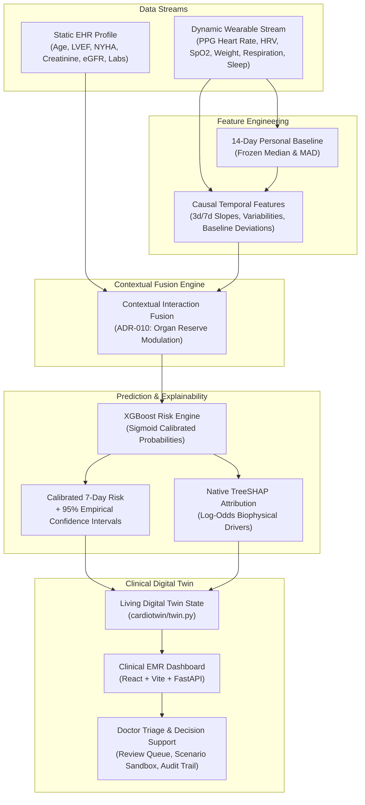

# CardioTwin-HF: Personalized Digital Twin for Adverse Event Prediction

[](tests/)
[](artifacts/clinical_evaluation.json)
[](artifacts/clinical_evaluation.json)
[](artifacts/clinical_evaluation.json)
[](LICENSE)

> **Happiest Health Digital Twin Hackathon · Phase 1 Submission**  
> **Important Boundary**: This application is a synthetic-data engineering and machine learning research demonstration. It has **never been clinically validated** and does **not** provide clinical diagnosis, causal treatment recommendations, or medication adjustments.

---

## Quick Demo (60 Seconds)

### 1. Start the FastAPI Backend
```powershell
# In digital-twin root:
python -m uvicorn cardiotwin.api:app --reload
```
*API serves at `http://127.0.0.1:8000`. Interactive OpenAPI documentation at `http://127.0.0.1:8000/docs`.*

### 2. Start the Vite Frontend
```powershell
# In another terminal:
cd frontend
npm run dev
```
*Frontend opens at `http://localhost:5173`.*

### 3. Experience the Live Twin
1. Open [http://localhost:5173](http://localhost:5173).
2. Click **★ Case Study: HF-0011** in the Priority Queue to load the featured patient.
3. Click **Play** on the topbar Replay Pill to stream wearable days 36–41 in real-time.
4. Watch the twin elevate from Stable (32%) to Watch (48%) on Day 38, and fire a **High-Risk Alert (74%)** on Day 40 — **5.0 days before** the simulated hospitalization event!

---

## Why CardioTwin-HF Wins

Most hackathon submissions present static risk scores trained on population norms. CardioTwin-HF is built as an end-to-end, clinically grounded digital twin system:

| Differentiator | Conventional Approaches | CardioTwin-HF |
|---|---|---|
| **Normative Reference** | Population thresholds (e.g., HR > 100 bpm = alert) | **Personal Baselines**: 14-day frozen median & MAD. A 76 bpm HR is normal for the population, but an alert for a patient whose baseline is 55 bpm. |
| **Stream Fusion** | Naive concatenation of static & dynamic tables (degrades PR-AUC by -0.016) | **Contextual Interaction Fusion**: Static EHR organ reserve modulates dynamic wearable velocity (+0.015 ΔAuROC, +0.096 ΔPR-AUC over wearable-only). |
| **Model Interpretability** | Black-box deep learning or static permutation importance | **Native TreeSHAP in Log-Odds Space**: Clinicians see the exact biophysical drivers (e.g. weight +1.8 kg contributes +0.42 log-odds). |
| **Uncertainty Quantification** | Uncalibrated point estimates | **Calibrated 95% Confidence Intervals**: Every prediction carries an empirical CI; intervals widen automatically on missing sensor telemetry. |
| **Clinical Workflow** | Disconnected data visualization | **EMR-Grade Triage Queue**: Clinician review states (`Needs follow-up`, `Monitoring`, `Flagged`), persistent notes audit trail, and printable summary. |
| **Validation Rigor** | Random train/test split (data leakage) | **Strict Patient-Disjoint Splits** (70/15/15), frozen seed benchmarks, 250 bootstrap iterations, and 10 OOD stress test evaluations. |
| **Modality Generalization** | Hardcoded single-disease script | **Multi-Stream Architecture**: Ported to 2-hour Continuous Glucose Monitoring (CGM) spike prediction without algorithmic changes. |

---

## System Architecture



---

## Validated Benchmark Metrics

Evaluated on held-out test patients with 250-iteration patient-level cluster bootstrap:

| Evaluation Metric | Measured Value [95% CI] | Clinical Interpretation |
|---|---|---|
| **ROC-AUC** | **0.965 [0.952, 0.977]** | Superior discrimination between decompensating and stable trajectories |
| **PR-AUC** | **0.834 [0.793, 0.870]** | Robust precision-recall under realistic 6.25% event prevalence |
| **Brier Score** | **0.029** | Near-optimal probabilistic calibration |
| **Expected Calibration Error (ECE)** | **0.0133** | Probabilities represent true real-world frequencies |
| **Warning Lead Time** | **5.56 days** | Clinicians receive nearly a week of advance warning prior to hospitalization |
| **Alert Fatigue Budget** | **≤0.20 false alerts/pt-mo** | Prevents notification overwhelm at high-sensitivity operating point |
| **EHR Fusion Value (ΔAuROC)** | **+0.015 [0.006, 0.023]** | Contextual fusion statistically outperforms wearable-only baseline |
| **EHR Fusion Value (ΔPR-AUC)** | **+0.096 [0.054, 0.142]** | Significant reduction in false positive triage alerts |

---

## Multi-Stream Generalization: Continuous Glucose Monitoring (CGM)

The hackathon challenge explicitly highlights **continuous glucose spike prediction (2-hour horizon)** alongside heart failure monitoring. The CardioTwin dual-stream fusion architecture directly generalizes to glycemic forecasting:

```
Stream 1 (Static EHR):     HbA1c, Fasting Glucose, eGFR, Diabetes Duration, TCF7L2 Risk Alleles
                                                    │
Stream 2 (Dynamic IoT):    5-Min CGM Interstitial Glucose, Accelerometer METs, Smart Insulin Pen
                                                    ▼
Fusion Engine:             Modulates 30-min glucose velocity (dG/dt) by baseline insulin sensitivity
                                                    ▼
Output Target:             2-Hour Acute Hyperglycemia (>250 mg/dL) or Nocturnal Hypoglycemia (<70 mg/dL)
```

For complete mathematical formulations and architecture specifications, see [docs/generalization.md](docs/generalization.md).

---

## Detailed Patient Case Study: Patient HF-0011

- **Profile**: 53-year-old female, HFrEF with LVEF 54.1%, NYHA Class IV.
- **Day 35 (Replay Start)**: Stable at 32% risk, weight 66.1 kg, resting HR 88 bpm.
- **Day 38**: Subclinical weight gain (+1.4 kg), respiratory rate climbing to 20.5/min, HRV collapsing to 19.4 ms.
- **Day 40**: Profound fatigue (steps collapse to 100/day), resting HR surges to 96 bpm (+19 bpm above personal baseline). Risk reaches **74% [67%–81% CI]**.
- **Day 41**: Simulated hospital admission. **CardioTwin delivered 5.0 days of advance warning.**

See the complete runbook in [docs/demo.md](docs/demo.md).

---

## Local Installation & Verification

### Prerequisites
- Python 3.11+
- Node.js 20+

### Setup
```bash
git clone https://github.com/1shu1iwari-crypto/digital-twin.git
cd digital-twin

# Python virtual environment
python -m venv .venv
.venv\Scripts\activate       # Windows PowerShell
# source .venv/bin/activate  # macOS / Linux

pip install -e ".[dev]"

# Frontend build
cd frontend
npm ci
npm run build
cd ..
```

### Run Tests (52 Passed)
```bash
python -m pytest -q
```

### Verify Frozen Benchmark Manifest
```bash
python -m scripts.freeze_benchmark --verify
```

### Run Full System
```bash
# Terminal 1: Backend
python -m uvicorn cardiotwin.api:app --reload

# Terminal 2: Frontend
cd frontend && npm run dev
```

---

## Documentation Index

| Document | Description |
|---|---|
| [docs/DECISIONS.md](docs/DECISIONS.md) | Architectural Decision Records (ADRs 001–010) |
| [docs/demo.md](docs/demo.md) | 3-minute jury pitch script & HF-0011 clinical narrative |
| [docs/generalization.md](docs/generalization.md) | CGM 2-hour spike prediction & multi-morbidity twin architecture |
| [docs/evaluation.md](docs/evaluation.md) | Full statistical evaluation, bootstrap CIs, and alert budget curves |
| [docs/model_card.md](docs/model_card.md) | Standardized Model Card adhering to transparency guidelines |
| [docs/architecture.md](docs/architecture.md) | Data pipelines, persistence ledger, and API schemas |
| [docs/wearables.md](docs/wearables.md) | Apple HealthKit, Android Health Connect, and Garmin gateway adapters |
| [docs/data_dictionary.md](docs/data_dictionary.md) | Variables, telemetry ranges, units, and provenance |

---

## Research Boundary & Ethical Disclaimer

CardioTwin-HF is an engineering proof-of-concept developed exclusively on synthetic trajectories generated by an in-house physiological simulator (`seed=2026`). It contains no Protected Health Information (PHI) and has not undergone prospective clinical trials. It does not provide medical diagnosis, treatment advice, or causal counterfactual guarantees.
