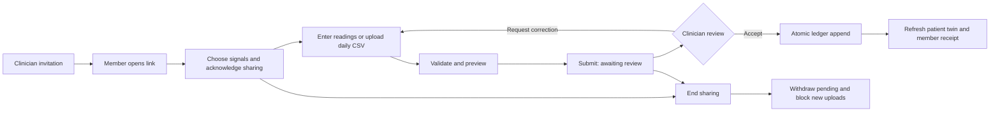

# Member-to-clinician wearable workflow

## Product decision

Build the care handoff first: a clinician links a member to one patient, the member chooses daily signals, summaries arrive in a review inbox, and the clinician accepts or requests a correction. No new reading reaches inference before acceptance. This makes the website useful before native device adapters are available.

This is a working local **fictional-data demonstration**, not a real-patient clinical service. The existing model remains trained and evaluated on synthetic data. The original synthetic-data API remains available without authentication; the new care routes have their own session and scope checks. Do not deploy the current application to collect real health data.

## Integration paths and priority

| Path | Member experience | Current implementation | Next requirement |
| --- | --- | --- | --- |
| Daily form | Open invitation, choose signals, type measured daily values, preview, send | Working | Real deployment identity and service controls |
| Daily CSV | Download the selected-signal template, fill consecutive daily rows, upload, preview, send | Working; 1–31 days, 64 KB browser limit, canonical units | Separate converters for each vendor's raw archive |
| Apple Health / Apple Watch | Open the companion, grant specific HealthKit read permissions, choose portal sharing, sync | Backend handoff and TypeScript adapter contract | Runnable iOS companion, HealthKit entitlements, on-device aggregation, device verification |
| Health Connect / Samsung | Enable approved records on Android; companion sends daily summaries | Backend handoff and TypeScript adapter contract | Android companion; per-record permissions; aggregate cumulative signals without double counting; separate background permission |
| Garmin | Authorize an approved cloud integration; daily summaries arrive through the same review boundary | Architecture only | Developer program access, server-side authorization, provider credentials and webhook validation |
| Other cloud providers | Authorize a registered application; summaries use the same boundary | Architecture only | Verify each provider's current availability, scopes, quotas and terms before implementing |

Apple documents HealthKit authorization in native applications: [Authorizing access to health data](https://developer.apple.com/documentation/healthkit/authorizing-access-to-health-data). Android documents foreground/background reads and recommends aggregation for cumulative records such as steps: [Read data](https://developer.android.com/health-and-fitness/health-connect/read-data). Garmin documents cloud-to-cloud data access and its separate device SDKs: [Connect Developer Program overview](https://developer.garmin.com/gc-developer-program/overview/).

The recommended sequence above is an engineering choice based on those constraints. Browser-only fake connection buttons would not supply native device authorization. The website therefore labels provider setup honestly and treats uploaded source names as member-reported provenance, not verified connections.

## Working journey

1. Open **Wearables → Enter clinician demo**. If `CARDIOTWIN_CLINICIAN_KEY` is configured, enter that key instead. Choose an existing fictional patient and create an invitation.
2. Copy the private, single-use link or open the member portal in a new tab for the demo. The link expires after 48 hours. Its token lives in the URL fragment, is exchanged by an explicit button press, and is removed from the visible URL after exchange. Only its hash is stored.
3. The member opens the invitation. The server binds the member session to exactly that patient. The portal loads neither the population dashboard nor other patients' records.
4. The member selects signals and acknowledges the recipient, demonstration purpose, review process, and withdrawal behavior. All choices start unchecked. Device permission and sharing with the care team are separate decisions.
5. The member enters one day's readings or uploads a CSV of consecutive days. Blank fields remain missing. The form shows canonical units and simulator input ranges. A clearly labeled fictional example allows a full walkthrough.
6. Preview validates source, dates, selected signals, duplicate aliases, units, bounds, and missingness. The member sees exactly which daily values would be sent. Preview performs no write.
7. **Send to care team** creates a pending receipt and an audit event. It does not change the telemetry ledger or risk estimate. A member can have one pending summary at a time. Identical retries return the existing receipt.
8. The clinician refreshes the inbox, selects the summary, and reviews each day's values, source, date and coverage. They may accept the entire consecutive batch or request correction with an explanatory note.
9. Acceptance checks the current ledger again, then appends the whole batch and marks the receipt accepted in one SQLite transaction. The twin cache is invalidated. A second review or a stale date receives a conflict; it cannot overwrite another reading or partially append a batch.
10. The member refreshes delivery history to see acceptance or the correction note. After acceptance, the next expected date advances. After rejection, the member can correct and resubmit the data.
11. Either participant can end sharing. New uploads stop, pending receipts become withdrawn, and pending acceptance is blocked. Accepted readings remain in the demo ledger. Resuming requires a new invitation and fresh sharing choices.

## State transitions

Invitation states: `invited → joined → active → revoked`; an unopened invitation can expire. Submission states: `pending → accepted | rejected | withdrawn`. Consent records preserve the selected metric keys, recipient, purpose, version, and consent time. Audit events record invitation creation/opening, consent, submission, review, and withdrawal. This is an application audit log, not a tamper-proof clinical audit system.

## Data contract

CSV starts with `date`, followed by canonical metric names such as `resting_hr,weight,steps`. One row is one local calendar day. Use the exact units displayed in the member portal: bpm, ms, /min, %, steps, kg, mmHg, and hours. No quoted fields, unknown columns, implicit unit guesses, repeated columns, or raw vendor archives are accepted by the browser converter. The server independently validates normalized readings.

The API accepts `{"days": [{"source": "manual", "timestamp": "YYYY-MM-DD", "readings": [{"metric": "weight", "value": 70, "unit": "kg"}]}]}`. It derives the patient from the member session, never a member-supplied patient ID. Source names represent declarations until a verified native/provider adapter is deployed. Up to 31 consecutive days are allowed, starting exactly after the current ledger. Repeated or out-of-order dates are rejected; missing sensors stay missing. A gap in calendar coverage must be resolved explicitly, not silently filled with invented values.

## API and session controls

| Route | Actor / effect |
| --- | --- |
| `GET /api/care/config` | Public synthetic-demo configuration and signal schema |
| `POST /api/care/login` | Clinician key → 8-hour HttpOnly session; limited to 10 attempts/minute per client IP per process |
| `GET /api/care/workspace` | Clinician-only connections, inbox and recent events |
| `POST /api/care/invitations` | Clinician creates patient-bound, 48-hour invitation |
| `POST /api/care/member/exchange` | Single-use token → 30-day scoped member session |
| `GET /api/care/member` | Only this member's patient label, sharing choices, next date and receipts |
| `POST /api/care/member/consent` | Record selected signals and acknowledgment |
| `POST /api/care/member/preview` | Validate daily batch without persistence |
| `POST /api/care/member/submissions` | Queue a receipt with retry deduplication |
| `POST /api/care/submissions/{id}/review` | Clinician accepts atomically or requests correction |
| `POST /api/care/member/revoke` | Member stops sharing and withdraws pending receipts |
| `POST /api/care/enrollments/{id}/revoke` | Clinician ends a connection |
| `POST /api/care/logout` | Invalidate browser care sessions |

All care mutations require `X-CardioTwin-Action: 1`, JSON, and the appropriate session except login and invitation exchange. Cookies use HttpOnly and SameSite=Strict; raw session tokens are hashed in SQLite. Care responses use `Cache-Control: no-store`. Set `CARDIOTWIN_SECURE_COOKIES=1` when serving behind HTTPS. Demo reset deliberately clears care invitations, sessions, consent, receipts and audit events together with fictional telemetry.

## Delivery plan for real device use

1. **Identity and care relationships:** replace the shared demo clinician key with managed authentication, individual clinician identities, MFA, verified member enrollment, organization/patient access checks, and invitation delivery through an approved channel. Protect every legacy patient/replay/import route as well as care routes. Remove/reset-isolate all synthetic-data controls.
2. **Device adapters:** implement native modules and permission-denial/revocation behavior on physical iOS/Android devices. Store the source timezone, measurement definitions and provider record IDs; use a resting-heart-rate measurement rather than an arbitrary pulse. Do not mix HRV definitions without validation. Keep raw provider authorization tokens server-side or in platform secure storage.
3. **Reliable synchronization:** use encrypted transport, background jobs with bounded retries, idempotency keys, provider-record deduplication, validated webhooks, backfill policies, stale-device indicators, and error recovery. Preserve source and observation time separately from received time. Do not automatically fabricate missed calendar days.
4. **Operational storage:** move the same review state machine to a transactional database with migrations, backups, immutable audit exports, retention/deletion workflows, monitoring, and organization isolation. Add pagination and review prioritization for larger cohorts.
5. **Clinical readiness:** obtain suitable licensed/outcome-linked data and domain review; validate the feature definitions and model externally. Keep the current synthetic risk model out of real treatment decisions. Document human review responsibility and service response times before a pilot.

No provider credentials, external invitations, live health records, deployment or GitHub upload are needed to exercise the implemented local workflow.

## Verification record

- 47 Python tests pass, including role boundaries, consent enforcement, scoped member history, one-use/expired invitations, submission idempotency, concurrent review, no-write previews, stale-ledger conflicts, withdrawal, restart persistence and reset isolation.
- Production TypeScript/Vite build passes.
- Browser checks use separate clinician/member contexts and exercise invitation, selected-signal consent, manual and CSV previews/submissions, clinician acceptance and correction, persisted provenance, member receipts, withdrawal and reload, with no JavaScript errors.
- Desktop and mobile layouts are checked from 360 to 1440 pixels; consent, member preview and clinician review screenshots are inspected.
